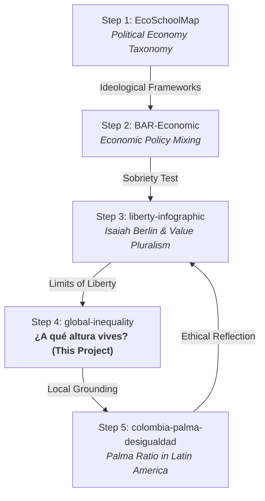
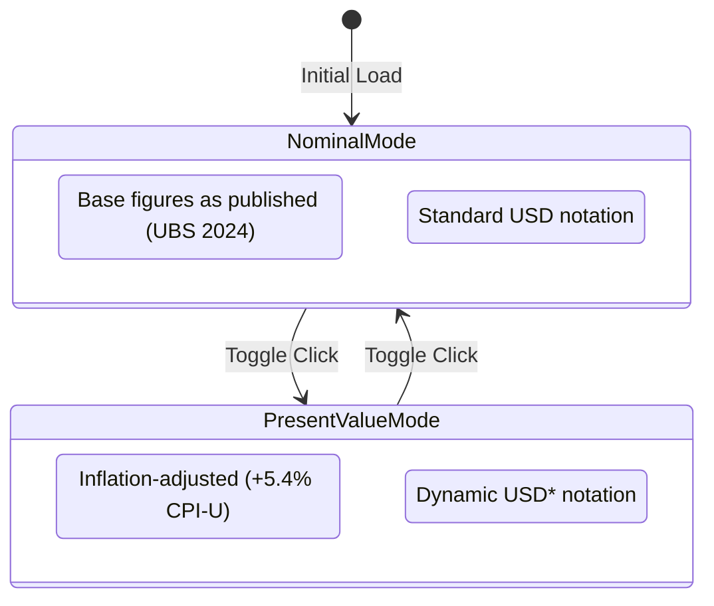

# 🌌 ¿A qué altura vives? · Paso 4 / How High Do You Stand? · Step 4

### *Interactive Scrollytelling and Epistemological Model of Global Wealth Disparity*
### *Visualización interactiva y modelo epistemológico de la brecha de riqueza mundial, convirtiendo patrimonio neto de personas naturales en altura física.*

---

[](https://willkwolf.github.io/global-inequality-21Century/)
[](https://willkwolf.github.io/global-inequality-21Century/docs/)
[](https://github.com/VibiumDev/vibium)
[](./docs/02-conceptualizacion/03-ontologia-unidad-de-analisis-persona-natural.md)
[](./docs/04-contratos-y-gobernanza/06-policy-editorial-maestra-pol-ed-001.md)
[](./docs/03-documentacion/07-roadmap-y-automatizacion-progresiva-dao.md)
[](https://creativecommons.org/licenses/by/4.0/)

---

## 📌 Overview

**¿A qué altura vives?** (*How High Do You Stand?*) is an interactive, zero-build scrollytelling web artifact that translates the astronomical concentration of global wealth into an intuitive physical scale.

By mapping individual net worth to physical elevation above the ground—where **1 step ($15\text{ cm}$) corresponds to $\$8,000\text{ USD}$** (approximating the global adult median of $\$8,910\text{ USD}$)—the project overcomes *psychic numbing* (Slovic, 2007) and makes visible what abstract financial notation obscures:
- **Pyramid Base ($s_8$, 40.7% of humanity):** Standing at just **$3.3\text{ cm}$** ($1.3\text{ in}$) above the ground (a matchbox).
- **Global Median ($s_7$, 50% percentile):** Reaching a single step of **$16.7\text{ cm}$** ($6.6\text{ in}$).
- **Global Upper Class ($s_5$, top 10%):** Elevated to **$5.5\text{ m}$** ($18\text{ ft}$, a giraffe).
- **The Top 1% ($s_4$):** Reaching an apartment building of **$18.75\text{ m}$** ($61\text{ ft}$).
- **Billionaires ($s_2$, 2,891 individuals):** Penetrating the stratosphere at **$18.75\text{ km}$** ($11.6\text{ mi}$).
- **The Apex ($s_1$, top individual):** Reaching **$13,828\text{ km}$** ($8,592\text{ mi}$) into outer space, far beyond medium Earth orbit and GPS satellites.

👉 **[Launch Interactive Visualization Live on GitHub Pages](https://willkwolf.github.io/global-inequality-21Century/)**  
📖 **[Access Interactive Knowledge Base on OpenWiki](https://willkwolf.github.io/global-inequality-21Century/docs/)**

---

## 🧭 Research Context: The Critical Thinking Path

This project serves as **Step 4** within **"La Ruta del Pensamiento Crítico"** (The Critical Thinking Path), a network of 5 autonomous web artifacts authored by `@willkwolf` linking economic philosophy, civic dilemmas, and empirical distribution:



---

## 🔬 Conceptual Framework

The model is grounded in Jan Pen’s seminal 1971 thought experiment (*The Parade of Dwarfs and Giants*), translated from annual flow income to accumulated balance-sheet **personal net worth** (assets minus liabilities).

### Epistemological Core Axioms
1. **Physical Scale Invariance (Lie Factor = 1.00):** Visual height maintains a strictly linear relationship with nominal wealth:
   $$H(W) = \frac{W}{W_{\text{ref}}} \times 0.15\text{ m}$$
2. **Ontological Purity (`EntityFilter`):** Exclusivity of **adult natural persons** ($\ge 20$ years). Corporations, sovereign states, and investment funds are strictly barred from the analysis to prevent category fallacies.
3. **Decoupling of Bodily Constant vs. Economic Metric:** The riser height ($15\text{ cm}$) is an invariant physiological constant; the monetary denomination ($W_{\text{ref}}$) dynamically calibrates to empirical median drift.
4. **Epistemic Modesty & Fallibilism:** Explicit disclosure of structural limitations, including corporate illiquidity at the apex, geographic purchasing power parity (PPP), and offshore wealth underreporting.
5. **Steelmanning Ethical Frameworks:** Impartial presentation of competing normative readings (Rawlsian distributive justice, Hayekian voluntary exchange, Piketty's capital dynamics, and Sen's capabilities).

---

## 🏛 Repository Architecture & Separation of Concerns

The repository enforces a canonical division of responsibilities governed by OpenWiki conventions:

```
Igualdad-Economica-2025/
├── docs/                                # CANONICAL OPENWIKI KNOWLEDGE BASE
│   ├── 01-data/                         # DATA: Sources, schemas, inflation adjustment
│   ├── 02-conceptualizacion/            # CONCEPTUALIZATION: Philosophy, Jan Pen, ontology
│   ├── 03-documentacion/                # DOCUMENTATION: Architecture, methodology, roadmap
│   ├── 04-contratos-y-gobernanza/       # GOVERNANCE: Master contracts & POL-ED-001 (v1.1.0)
│   ├── 05-auditorias/                   # AUDITS: Epistemological audit reports & checklists
│   ├── 06-presentacion/                 # PRESENTATION: Visual grammar, SVG assets, UX
│   ├── index.html                       # Docsify interactive reader
│   ├── _sidebar.md                      # Navigation sidebar
│   └── README.md                        # Documentation portal
├── src/                                 # MAINTENANCE & ENGINE MODULES
│   ├── adapters/                        # Source adapters (UBS, Forbes, WID)
│   ├── agent/                           # AI adaptation agent & recalibrator
│   ├── assets/                          # SVG icon inventory & visual guardrails
│   ├── contracts/                       # Story model & JSON schemas
│   ├── domain/                          # Ontology definitions & EntityFilter
│   ├── drift/                           # Drift detection engine (4 quadrants)
│   ├── guardrails/                      # Safety circuit breakers
│   ├── i18n/                            # Inflation adjuster & localized NumberFormatter
│   ├── renderer/                        # Deterministic HTML compiler
│   └── vibium/                          # Browser test runners & verification harness
├── tests/                               # TEST SUITES (100% Deterministic Passing)
│   ├── unit/                            # Unit tests for formatters, drift, and contracts
│   ├── three-scenarios.test.mjs         # 3 drift scenarios validation
│   ├── vibium-verification.test.mjs     # Dual-viewport browser verification (12 edge cases)
│   ├── parallax-*.test.mjs              # Property-Based Testing (PBT) for parallax
│   └── synthetic-robustness.test.mjs    # 25 Monte Carlo iterations in isolated sandbox
├── OpenWiki/                            # OPERATIONAL SCRIPTS & SPEC DATA
│   ├── spec/data.json                   # Canonical frozen dataset
│   ├── scripts/validate-data.js         # Deterministic data validator
│   └── scripts/apply-data.js            # Dynamic HTML injector
├── Escala-visual-de-riqueza-mundial.html # PRIMARY ZERO-BUILD PRESENTATION ARTIFACT
├── index.html                           # Static redirection entry point for GitHub Pages
└── package.json                         # Dependencies & test scripts
```

---

## 📊 Data and Sources

All statistical observations are anchored in verifiable primary sources:

| Source | Cut-off Date | Coverage | Role in System |
|---|---|---|---|
| **UBS Global Wealth Report 2024** | 2024-12-31 | 56 markets, 5.36B adults, 92% of global wealth | Defines global median ($W_{50} = \$8,910\text{ USD}$), strata $s_3$ to $s_8$. |
| **Forbes Real-Time Billionaires** | May 2026 | Top global fortunes | Defines apex ($s_1$, Elon Musk at $\$737.5\text{B}$) and billionaire count ($s_2$, 2,891). |
| **BLS CPI-U Series** | 2024–2026 | U.S. Consumer Price Index | Supplies cumulative inflation rate ($+5.40\%$) for Present Value (`USD*`) mode. |

Data is cryptographically tracked via SHA-256 hashes in the [`Change Log Ledger`](./docs/03-documentacion/08-historial-y-registro-inmutable-de-cambios.md).

---

## ⚙️ Methodology & Dynamic Calibration

The system prevents obsolescence through three automated mechanisms:

1. **Dynamic Year Invariant:** `target_year = new Date().getFullYear()` runtime context.
2. **Dynamic Median Recalibration (`ScaleRecalibrator`):** Recomputes step valuation ($W_{\text{ref}}$) upon median data drift without altering visual constants.
3. **Present Value (`USD*`) Toggle:** A frosted-glass UI control switches dynamically between historical nominal figures and inflation-adjusted values, scaling monetary terms while preserving spatial proportions.



---

## 📜 Governance & Master Contracts

The project is governed as an academic artifact under five specialized master contracts and the overarching **POL-ED-001 (v1.1.0)** standard:

1. **[Data Governance Contract (CT-DATA-001)](./docs/04-contratos-y-gobernanza/01-contrato-gobernanza-de-datos.md):** Provenance, schema integrity, and SHA-256 tracking.
2. **[Epistemological Governance Contract (CT-EPIS-001)](./docs/04-contratos-y-gobernanza/02-contrato-gobernanza-epistemologica.md):** Thesis boundaries, natural person filter, and conceptual drift shielding.
3. **[Editorial Governance Contract (CT-EDIT-001)](./docs/04-contratos-y-gobernanza/03-contrato-gobernanza-editorial.md):** High semantic density, bilinguality (ES/EN), and narrative progression.
4. **[Visual Governance Contract (CT-VIS-001)](./docs/04-contratos-y-gobernanza/04-contrato-gobernanza-visual.md):** Semantic isomorphism, WCAG 2.1 AA contrast ($> 4.5:1$), and touch target compliance ($\ge 44\times 44\text{ px}$).
5. **[Technical & Publication Contract (CT-TECH-001)](./docs/04-contratos-y-gobernanza/05-contrato-gobernanza-tecnica-y-publicacion.md):** Zero-build integrity, relative URLs, and CI/CD quality gates.
6. **[Master Editorial Policy POL-ED-001 (v1.1.0)](./docs/04-contratos-y-gobernanza/06-policy-editorial-maestra-pol-ed-001.md):** Transversal audit framework with the 8 normative vectors and 20-point checklist.

---

## 🎨 Visual Artifacts & Icon Inventory

The presentation artifact implements an 8-stage atmospheric parallax palette:
- **Deep Space (`--bg1: #000000`):** Apex orbit ($13,828\text{ km}$, Satellite).
- **Stratosphere (`--bg2` / `--bg3`):** Billionaires ($18.75\text{ km}$, Rocket).
- **Urban Atmosphere (`--bg4` / `--bg5`):** Top 1% and Upper Class ($18.75\text{ m}$ to $5.5\text{ m}$, Skyscraper & Streetlight).
- **Ground & Earth (`--bg6`, `--bg7`, `--bg8`):** Global median ($16.7\text{ cm}$, Stair Step) and Pyramid base ($3.3\text{ cm}$, Matchbox on ground).

All SVG icons are canonically managed in `src/assets/icon-inventory.js` and documented in [`docs/06-presentacion/02-inventario-de-activos-svg-e-iconografia.md`](./docs/06-presentacion/02-inventario-de-activos-svg-e-iconografia.md).

---

## 🧪 Reproducibility & Quality Gates

The system includes a 100% deterministic test harness:

```bash
# 1. Install dependencies
npm install

# 2. Validate canonical JSON data and schema consistency
npm run validate-spec

# 3. Compile and inject data into the presentation artifact
npm run apply-spec

# 4. Run the full deterministic test suite
npm test

# 5. Run the macroeconomic calibration stress test
npm run test:stress

# 6. Run synthetic Monte Carlo robustness test (25 isolated sandbox iterations)
npm run test:robustness
```

### Continuous Integration
Automated GitHub Actions pipelines (`.github/workflows/validate-spec.yml` and `deploy.yml`) enforce all quality gates before deployment to GitHub Pages.

---

## 📚 References & Citation

### Primary Empirical Sources
- **UBS Group AG & Credit Suisse Research Institute (2024).** *Global Wealth Report 2024*. Zürich, Switzerland.
- **Forbes Media LLC (2026).** *Forbes Real-Time Billionaires List* (Cut-off: May 2026). New York, NY.
- **U.S. Bureau of Labor Statistics (2026).** *Consumer Price Index for All Urban Consumers (CPI-U)*. Washington, D.C.

### Theoretical Foundations
- **Pen, Jan (1971).** *Income Distribution: Facts, Theories, and Policies*. Praeger Publishers, New York.
- **Tufte, Edward R. (1983).** *The Visual Display of Quantitative Information*. Graphics Press, Cheshire, CT.
- **Slovic, Paul (2007).** "Psychic Numbing and Genocide." *Judgment and Decision Making*, 2(2), 79–95.
- **Rawls, John (1971).** *A Theory of Justice*. Harvard University Press, Cambridge, MA.
- **Piketty, Thomas (2014).** *Capital in the Twenty-First Century*. Belknap Press, Cambridge, MA.

### Citation
```bibtex
@misc{artunduaga2026altura,
  author = {Artunduaga Viana, William Camilo},
  title = {¿A qué altura vives? La brecha de riqueza mundial convertida en altura física},
  year = {2026},
  publisher = {GitHub},
  howpublished = {\url{https://willkwolf.github.io/global-inequality-21Century/}},
  note = {OpenWiki Canonical Documentation: \url{https://willkwolf.github.io/global-inequality-21Century/docs/}}
}
```

---

## 📄 License

This repository and its visual and documentary artifacts are published under the **Creative Commons Attribution 4.0 International License (CC BY 4.0)**.  
Underlying software scripts are licensed under the **MIT License**.
