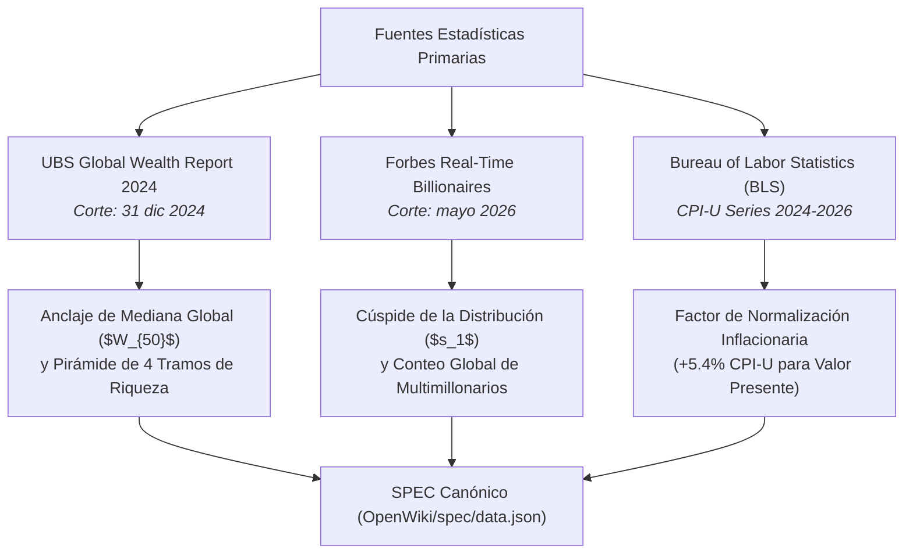

# Fuentes Primarias, Procedencia y Trazabilidad Empírica

## 1. Declaración de Fuentes Oficiales

La base empírica de la visualización interactiva y el modelo matemático de estratos se fundamenta en tres fuentes canónicas primarias:

---

## 2. Inventario de Fuentes y Procedencia de Metadatos

### 2.1. UBS Global Wealth Report 2024
* **Publicador:** UBS Group AG / Credit Suisse Research Institute.
* **Fecha de Publicación Oficial:** Julio de 2024.
* **Fecha de Corte de Datos:** 31 de diciembre de 2024.
* **Cobertura Geográfica:** 56 mercados que abarcan más del 92% de la riqueza de los hogares globales.
* **Población Objetivo:** 5.360 millones de adultos naturales.
* **Métricas Extraídas:**
  - Mediana de riqueza global por adulto ($W_{50}$): **$8.910 USD**.
  - Media aritmética de riqueza global: **$87.400 USD**.
  - Tramo inferior de la pirámide (< $10.000 USD): **40,7% de la población adulta**.
  - Riqueza media del estrato base ($s_8$): **$1.748 USD**.
  - Estrato clase media global ($s_6$): promedio de **$36.000 USD** (percentil 70-80).
  - Umbral del estrato alto ($s_5$): **$293.000 USD** (percentil 90-95).
  - Umbral de ingreso al 1% superior ($s_4$): **$1.000.000 USD**.
  - Umbral del 0.1% superior ($s_3$): **$3.700.000 USD**.

### 2.2. Forbes Real-Time Billionaires List
* **Publicador:** Forbes Media LLC.
* **Fecha de Corte:** Mayo de 2026.
* **Cobertura:** Registro en tiempo real de patrimonios individuales superiores a $1.000 millones de USD.
* **Métricas Extraídas:**
  - Individuo en la cúspide global ($s_1$): Elon Musk ($737.500 millones de USD al corte mayo 2026).
  - Número total de multimillonarios globales ($s_2$): **2.891 individuos**.
  - Umbral de entrada a la élite multimillonaria: **$1.000 millones de USD**.

### 2.3. Bureau of Labor Statistics (BLS) — Consumer Price Index (CPI-U)
* **Publicador:** U.S. Bureau of Labor Statistics.
* **Serie:** All Urban Consumers (CPI-U), base dic 2024 a mayo 2026.
* **Tasa Acumulada Oficial:** **+5,40%**.
* **Propósito:** Proveer el factor deflactor/inflacionario oficial para el conmutador de **Valor Presente** (`USD*`).

---

## 3. Matriz de Adaptadores y Respaldo Secundario

| Adaptador | Fuente | Propósito | Nivel de Confianza | Criterio de Respaldo |
|---|---|---|---|---|
| `UbsSourceAdapter` | UBS Global Wealth Report | Definición de distribución del 99% de la población | **Alto** | Metodología de balances financieros de hogares de Anthony Shorrocks. |
| `ForbesAdapter` | Forbes Real-Time | Definición de la cúspide ($s_1, s_2$) | **Medio-Alto** | Valuación de activos públicos y privados auditados. |
| `WidSourceAdapter` | World Inequality Database (WID) | Fuente de validación cruzada para percentiles continuos | **Muy Alto** | Metodología DINA (Distributional National Accounts) de Piketty, Saez y Zucman. |
| `WorldBankAdapter` | World Bank PIP | Contraste de pobreza y consumo en la base | **Alto** | Datos de encuestas de hogares multilaterales. |

---

## 4. Hash Criptográfico y Verificación de Integridad

Cada actualización del dataset genera un hash criptográfico SHA-256 de los datos en crudo que queda registrado en el `Change Log Ledger`. Ningún dato derivado puede propagarse a producción si su hash no coincide con la firma del commit verificado.
