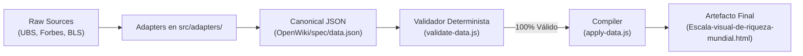

# Modelo Canónico de Datos y Esquema JSON

## 1. Principio Arquitectónico del Modelo Canónico

El modelo canónico define la estructura formal inmutable que desacopla la ingestión empírica de la compilación visual.



---

## 2. Invariante de Separación: Cálculo vs. Presentación

El sistema obedece estrictamente el principio de desacoplamiento numérico:
$$\text{Cálculo Matemático (IEEE 754 Float)} \quad \neq \quad \text{Presentación Textual (Localizada)}$$

1. **En tiempo de cálculo:** Todos los valores se almacenan y operan como enteros o números decimales puros sin formatear (ej. `737500000000`, `8910`, `13828125`).
2. **En tiempo de presentación:** El formateo textual se delega exclusivamente a `Intl.NumberFormat` mediante el módulo `src/i18n/number-formatter.js`, garantizando la regla:
   $$\text{CURRENCY (USD)} \quad \neq \quad \text{LOCALE (es / en)}$$
   - En español (`es`): `1.748 USD` / `$1.748,50`.
   - En inglés (`en`): `1,748 USD` / `$1,748.50`.

---

## 3. Especificación Formal de Campos (Esquema v2.1.0)

Cada nodo de estrato ($s_i$) dentro del arreglo `strata` debe cumplir rigurosamente con los siguientes campos obligatorios:

```typescript
interface Stratum {
  id: string;                      // Identificador único (s1, s2, ..., s8)
  rank_order: number;              // Orden descendente (1 = cúspide, 8 = base)
  name: { es: string; en: string };// Denominación bilingüe del estrato
  population: {
    percentage: number;            // Porcentaje sobre la población adulta total
    absolute_count?: number;       // Conteo absoluto de individuos (ej. 2891)
    label: { es: string; en: string };
  };
  net_worth: {
    usd_nominal: number;           // Valor matemático exacto en USD nominal
    usd_present_value?: number;    // Valor ajustado por inflación CPI-U
    threshold_label: { es: string; en: string };
  };
  physical_height: {
    meters_nominal: number;        // Altura física exacta según la metáfora de Pen
    meters_pv?: number;            // Altura ajustada a valor presente
    human_scale_comparison: { es: string; en: string };
  };
  svg_icon: {
    symbol_id: string;             // Referencia al inventario de iconos SVG
    semantic_role: string;         // Rol funcional (cohete, rascacielos, zapato)
    viewBox: string;               // Viewbox estandarizado
  };
  pedagogical_caption: {
    es: string;
    en: string;
  };
}
```

---

## 4. Contratos de Validación Determinista

El validador determinista (`OpenWiki/scripts/validate-data.js` y `npm run validate-spec`) verifica sin dependencias externas:
1. **Monotonía Estricta:** La altura física y el patrimonio neto deben decrecer monótonamente:
   $$\text{NetWorth}(s_i) > \text{NetWorth}(s_{i+1}) \quad \forall i \in \{1, \dots, N-1\}$$
2. **Exclusividad Ontológica:** Ningún estrato puede representar personas jurídicas o patrimonios agregados no atribuibles a personas naturales.
3. **Bilingüismo Total:** Cada texto informativo debe contar con su correspondiente clave en español e inglés sin valores nulos ni cadenas vacías.
4. **Consistencia Geométrica:** La altura métrica calculada debe coincidir con la fórmula del escalón con una tolerancia de error inferior al $0,001\%$:
   $$H(s_i) = \frac{\text{NetWorth}(s_i)}{W_{\text{ref}}} \times 0.15 \text{ m}$$
