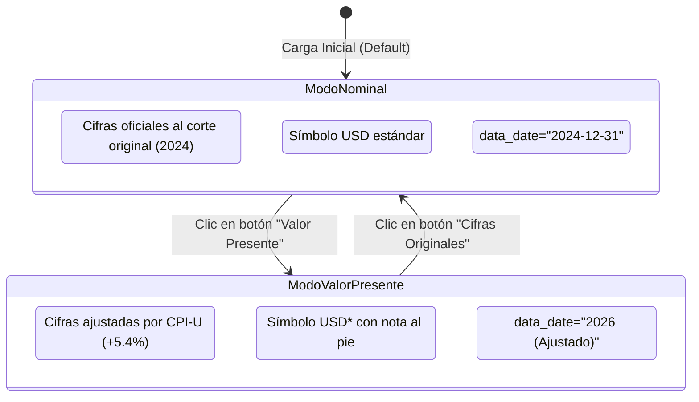

# Normalización Inflacionaria y Mecánica de Valor Presente

## 1. El Dilema de la Obsolescencia Temporal de las Cifras Monetarias

Los reportes patrimoniales de referencia se publican con fechas de corte diferidas (ej. UBS al 31 de diciembre de 2024; Forbes en tiempo real mayo 2026). Presentar cifras históricas nominales sin advertencia introduce una distorsión cognitiva en el lector, mientras que forzar una actualización sin respaldo metodológico rompe la trazabilidad empírica.

Para resolver esta tensión sin alterar los datos brutos de la fuente, el sistema implementa una **arquitectura de conmutación dual** gobernada por el módulo `src/i18n/inflation-adjuster.js`.

---

## 2. Metodología de Ajuste por Inflación (CPI-U)

El factor de corrección temporal utiliza el índice oficial **CPI-U** (*Consumer Price Index for All Urban Consumers*) del *Bureau of Labor Statistics* (BLS):

$$\text{Tasa de Inflación Acumulada } (\pi) = +5,40\% \quad (2024-12-31 \to 2026-05)$$
$$\text{Factor de Ajuste } (k_{\text{inf}}) = 1 + \pi = 1,054$$

### 2.1. Ecuaciones de Transformación
Para cada estrato $s_i$ con patrimonio nominal $W_i$:
$$W_i^* = W_i \times k_{\text{inf}} = W_i \times 1,054$$

Dado que la calibración económica del escalón patrón ($W_{\text{ref}}$) también se actualiza por la inflación de la mediana:
$$W_{\text{ref}}^* = W_{\text{ref}} \times 1,054$$

La altura física calculada para cada estrato permanece invariante bajo traslación homotética:
$$H_i^* = \frac{W_i^*}{W_{\text{ref}}^*} \times 0,15\text{ m} = \frac{W_i \times 1,054}{W_{\text{ref}} \times 1,054} \times 0,15\text{ m} \equiv H_i$$

> [!NOTE]
> **Preservación Geométrica:** El ajuste inflacionario uniforme escala las magnitudes nominales en dólares (`USD*`) pero preserva con exactitud matemática las alturas físicas del viaje visual, evitando cualquier distorsión en la metáfora espacial de Jan Pen.

---

## 3. Comportamiento del Conmutador Visual en el Artefacto

El artefacto interactivo (`Escala-visual-de-riqueza-mundial.html`) implementa un botón con estética de vidrio esmerilado (*frosted glass*) en la esquina superior derecha (`.pv-toggle-btn`):

### 3.1. Especificaciones de Accesibilidad y DOM
1. **Target Táctil:** El botón cumple con dimensiones mínimas de $44 \times 44\text{ px}$.
2. **Atributo `aria-pressed`:** Refleja en tiempo real el estado (`true`/`false`) para lectores de pantalla.
3. **Indicador LED:** Un punto luminoso (`.pv-led`) cambia de ámbar tenue a azul eléctrico brillante cuando el modo está activo.
4. **Anuncio en tiempo real:** Se emite una actualización por `aria-live="polite"` informando el cambio de régimen monetario al usuario asistido.
