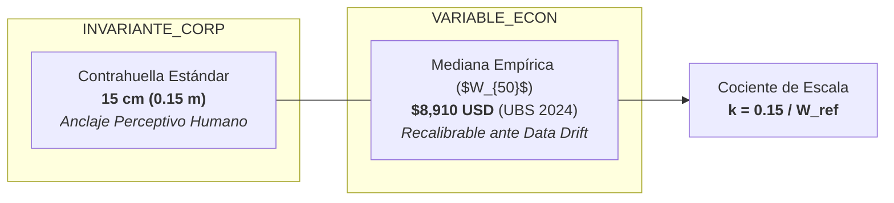

# La Abstracción de Altura Física y la Regla del Escalón Patrón

## 1. La Función de Transformación Lineal

La relación entre patrimonio neto y elevación física no es logarítmica ni exponencial; es estrictamente **lineal**, lo que garantiza que las proporciones relativas en el espacio físico sean un reflejo isomórfico perfecto de las proporciones en el espacio monetario.

$$H(W) = \frac{W}{W_{\text{ref}}} \times H_{\text{step}}$$

Donde:
* $W$: Patrimonio neto de la persona o estrato expresado en dólares estadounidenses nominales (USD).
* $H_{\text{step}}$: Altura física del peldaño estándar de escalera, fijada como invariante universal en **$0,15\text{ m}$ ($15\text{ cm}$)**.
* $W_{\text{ref}}$: Parámetro económico de calibración, anclado empíricamente a la mediana global ($W_{50} = \$8.910\text{ USD}$ empírico / $\$8.000\text{ USD}$ nominal pedagógico).
* $H(W)$: Altura física resultante en metros.

---

## 2. El Criterio del *Lie Factor* de Edward Tufte

En la visualización gráfica de datos (Tufte, 1983), el *Lie Factor* mide la fidelidad entre la representación visual y la variación numérica real:

$$\text{Lie Factor} = \frac{\text{Variación porcentual en la gráfica}}{\text{Variación porcentual en los datos}}$$

$$\text{Lie Factor} = \frac{(H_A - H_B) / H_B}{(W_A - W_B) / W_B} = \frac{\frac{W_A/W_{\text{ref}} \times 0.15 - W_B/W_{\text{ref}} \times 0.15}{W_B/W_{\text{ref}} \times 0.15}}{(W_A - W_B) / W_B} \equiv 1,000$$

> [!IMPORTANT]
> Un *Lie Factor* de **$1,00$** certifica que la gráfica no exagera ni atenúa la desigualdad: una persona con diez veces más riqueza aparece exactamente diez veces más alta en el espacio virtual.

---

## 3. Preservación del Anclaje Corporal y Desacoplamiento

El sistema introduce una distinción metodológica crucial para la longevidad del artefacto:

1. **La constante fisiológica ($H_{\text{step}} = 15\text{ cm}$):** Corresponde a la biomecánica de la marcha humana (normas arquitectónicas internacionales de contrahuella). Es un invariante permanente de diseño.
2. **El parámetro económico ($W_{\text{ref}}$):** Representa el valor monetario de dicho peldaño. Si la riqueza global crece o sufre inflación, $W_{\text{ref}}$ se recalibra dinámicamente sin necesidad de alterar la arquitectura visual ni el código del renderer.

