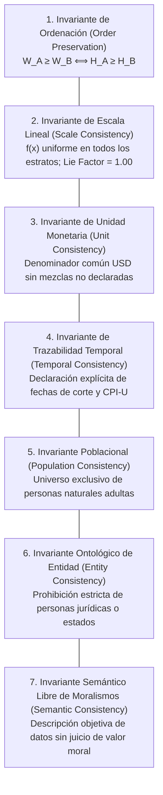

# Fronteras Epistémicas, Límites del Conocimiento y Falibilismo

## 1. Declaración de Falibilismo y Modestia Epistémica

Ningún modelo estadístico es idéntico a la realidad que describe. Toda representación visual es una simplificación intencionada que selecciona ciertas variables y omite otras.

Este artefacto no pretende ser una teoría general de la justicia económica ni un censo omnisciente de la humanidad. Su propósito es específico, delimitado y falsable: **hacer observable la asimetría en la distribución de la riqueza neta personal mediante un escalamiento espacial lineal riguroso**.

---

## 2. Los Siete Invariantes Epistemológicos

El ecosistema mantiene siete contratos epistémicos inmutables que no pueden ser relajados por ningún agente ni intervención de mantenimiento:

---

## 3. Taxonomía de Desviaciones: Limitación vs. Invalidación

El sistema clasifica las limitaciones de la abstracción en cuatro niveles de impacto:

| Categoría | Criterio de Impacto | Ejemplos en el Proyecto | Protocolo Operativo |
|---|---|---|---|
| **A. Limitación Aceptable** | La abstracción sigue siendo válida; requiere nota metodológica. | Subregistro de activos en jurisdicciones offshore y opacidad en paraísos fiscales. | Documentar el sesgo de subestimación en la ficha de procedencia. |
| **B. Limitación Controlable** | Discrepancia matemática o temporal que puede ser mitigada en UI/datos. | Diferencia entre la mediana empírica ($8.910 USD) y el peldaño nominal ($8.000 USD). | Implementar el módulo `ScaleRecalibrator` y el conmutador de Valor Presente. |
| **C. Limitación Significativa** | Afecta la interpretación cualitativa si no se acompaña de contexto. | Ilíquidez de los activos en la cúspide (acciones de empresas vs. efectivo disponible). | Incluir advertencia explícita en el micro-copy del estrato $s_1$. |
| **D. Invalidación Conceptual** | Destruye la relación lógica de representación. Bloquea la publicación. | Incorporar corporaciones en la cúspide o una mediana de riqueza negativa ($\le 0$). | Disparar `ABSTRACTION_LIMIT_REACHED` y suspender el pipeline de CI/CD. |

---

## 4. Qué Explica y Qué NO Explica la Abstracción

### Lo que la Abstracción SÍ explica con rigor:
1. La brecha astronómica de magnitudes entre percentiles globales.
2. La masa poblacional concentrada en los primeros centímetros del suelo (el 98% de la humanidad vive por debajo del techo de una casa de dos pisos).
3. La desconexión total entre el esfuerzo físico individual y el rendimiento del capital acumulado.

### Lo que la Abstracción NO explica y NO debe inducir a concluir:
1. **No mide bienestar ni felicidad:** Una persona en la base ($s_8$) con redes comunitarias sólidas puede tener mayor calidad de vida que un individuo sobreendeudado en un estrato superior.
2. **No explica la movilidad social:** La escala es una fotografía sincrónica (corte transversal), no un modelo dinámico de trayectorias de vida.
3. **No juzga la legitimidad del patrimonio:** No distingue entre riqueza generada por innovación tecnológica, herencia dinástica, rentas monopólicas o corrupción institucional.
