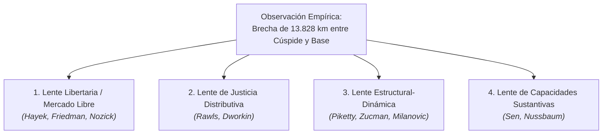

# Multiperspectivismo, Steelmanning y Teorías de la Justicia

## 1. El Principio de Caridad Interpretativa (*Steelmanning*)

El artefacto rechaza explícitamente el adoctrinamiento ideológico y la caricaturización de posturas económicas rivales. Siguiendo las directrices del Contrato Maestro POL-ED-001 (Vector 3), las diversas lecturas morales de la desigualdad se exponen bajo su formulación más robusta e intelectualmente honesta (*steelmanning*).

---

## 2. Matriz de Cuatro Lentes Normativas ante la Brecha de Riqueza

### 2.1. Perspectiva Libertaria y de Mercado Libre (Hayek, Nozick)
* **Tesis Central:** La desigualdad no es injusta en sí misma si surge de transacciones voluntarias en un mercado abierto sin coerción estatal. La riqueza en la cúspide ($s_1, s_2$) refleja la creación de valor para millones de consumidores (ej. vehículos eléctricos, redes de satélites, software global).
* **Steelmanning:** Forzar una igualación artificial de resultados requiere vulnerar la libertad individual y destruir el mecanismo de precios que coordina la economía, empobreciendo a la sociedad en su conjunto.
* **Trade-off Reconocido:** El mercado libre tolera asimetrías extremas y asume que el punto de partida biológico o hereditario no es equitativo.

### 2.2. Perspectiva Rawlsiana de Justicia como Equidad (Rawls)
* **Tesis Central:** Las desigualdades socioeconómicas solo son moralmente admisibles si satisfacen el *Principio de la Diferencia*: deben operar para el máximo beneficio de los miembros menos favorecidos de la sociedad ($s_8$).
* **Steelmanning:** Desde la *Posición Original* y bajo el *Velo de la Ignorancia*, ningún individuo racional aceptaría un orden social donde el 40% de la humanidad vive a centímetros del suelo a menos que esa concentración extrema financie bienes públicos que eleven el piso mínimo de existencia.
* **Trade-off Reconocido:** Definir qué tanto beneficia la cúspide a la base es empíricamente disputado y puede limitar la retribución al talento extraordinario.

### 2.3. Perspectiva de Acumulación y Dinámica del Capital (Piketty, Milanovic)
* **Tesis Central:** La ley histórica $r > g$ (el rendimiento del capital supera la tasa de crecimiento económico) concentra la riqueza de forma acumulativa en dinastías privadas, amenazando la democracia y la meritocracia.
* **Steelmanning:** Cuando la riqueza de la cúspide alcanza alturas planetarias ($13.828\text{ km}$), el poder económico se traduce inevitablemente en poder político desmedido (captura regulatoria, control de medios, influencia electoral), socavando el principio democrático de *"un ciudadano, un voto"*.
* **Trade-off Reconocido:** La imposición de impuestos globales al capital enfrenta desafíos masivos de coordinación entre estados y riesgo de fuga de capitales.

### 2.4. Perspectiva de Capacidades Humanas (Sen, Nussbaum)
* **Tesis Central:** La métrica última de la justicia no es el dinero acumulado sino la libertad sustantiva de cada persona para llevar una vida que tenga razones para valorar (*capabilities*).
* **Steelmanning:** La pobreza en la base ($s_8$) no es simplemente una cifra baja en una cuenta bancaria; es una privación de libertad real (acceso a salud, nutrición, educación y autonomía decisional) que impide el florecimiento humano.
* **Trade-off Reconocido:** Traducir capacidades en políticas públicas universales requiere acuerdos éticos complejos más allá del crecimiento del PIB.

---

## 3. El Conflicto Ineludible: Habitar la Tensión

El artefacto no impone una síntesis artificial. La experiencia visual busca que el usuario experimente el vértigo matemático de la concentración y reflexione críticamente sobre los costes de oportunidad y los compromisos normativos que cada sociedad debe asumir.
