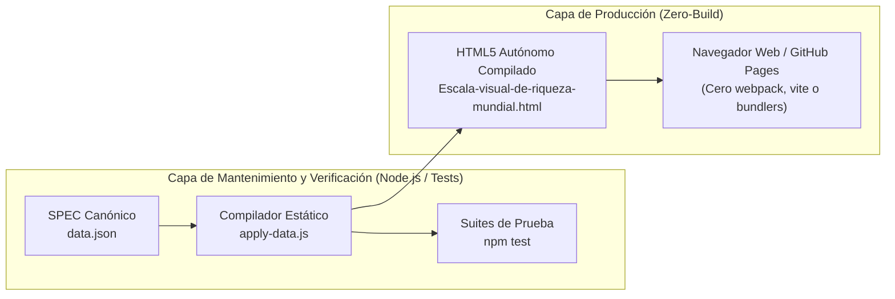

# Arquitectura Técnica, Modularidad y Principio Zero-Build

## 1. El Principio Zero-Build en Producción

Siguiendo las mejores prácticas de preservación digital y reducción de dependencias frágiles, el artefacto publicado (`Escala-visual-de-riqueza-mundial.html`) implementa una arquitectura **Zero-Build**:

### Ventajas de la Arquitectura Zero-Build:
1. **Longevidad Extrema:** Garantiza que el artefacto pueda ejecutarse sin degradación dentro de 20 o 30 años sin depender de gestores de paquetes obsoletos.
2. **Inspeccionabilidad Directa:** Cualquier investigador o auditor puede abrir el código fuente en el inspector del navegador y verificar la correspondencia entre datos y DOM.
3. **Despliegue Instantáneo:** Compatible directamente con GitHub Pages mediante `_config.yml` y `.nojekyll`.

---

## 2. Organización Modular del Código Fuente (`src/`)

El código de mantenimiento y gobernanza en `src/` está organizado bajo estricta separación de responsabilidades:

| Directorio / Archivo | Responsabilidad Primaria |
|---|---|
| `src/canonical-model.js` | Generador del objeto canónico en memoria a partir de fuentes primarias. |
| `src/adapters/` | Conectores especializados para ingesta de datos (UBS, Forbes, WID). |
| `src/domain/domain-definition.js` | Definición de invariantes ontológicos y filtro de personas naturales (`EntityFilter`). |
| `src/drift/drift-engine.js` | Motor de clasificación y detección de desviaciones estadísticas o metodológicas. |
| `src/guardrails/guardrails.js` | Mecanismo de frenado de emergencia ante violaciones de la abstracción. |
| `src/i18n/number-formatter.js` | Formateador numérico centralizado compatible con estándares bilingües. |
| `src/i18n/inflation-adjuster.js` | Normalizador de inflación temporal CPI-U y conmutación de Valor Presente. |
| `src/renderer/html-compiler.js` | Motor determinista de inyección de datos en la plantilla visual. |
| `src/telemetry/telemetry-logger.js` | Registro estructurado de eventos y auditoría en formato JSON Lines. |
| `src/vibium/` | Harness de pruebas visuales y de accesibilidad sobre navegadores reales. |

---

## 3. Desacoplamiento del DOM y la Lógica

El artefacto visual nunca manipula datos crudos en variables dispersas. Los datos se inyectan en una sección estructurada:
- En el DOM: Atributos `data-nominal`, `data-pv`, `data-height-nominal`, `data-height-pv`.
- En el script: Un diccionario centralizado `STRINGS` que contiene todas las cadenas bilingües indexadas por clave.
