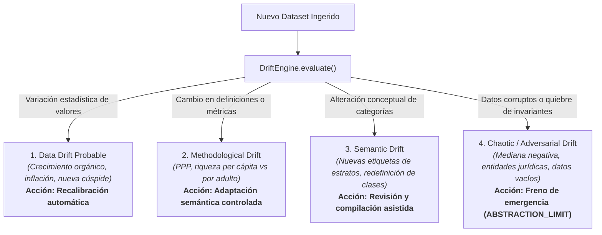

# Motor de Drift: Clasificación de Desviaciones y Resiliencia

## 1. Taxonomía de Deriva del Sistema (`DriftEngine`)

El motor de detección de deriva (`src/drift/drift-engine.js`) clasifica cualquier variación en los datos de entrada en cuatro cuadrantes normativos:

---

## 2. Definición Operativa de los Cuatro Escenarios

### 2.1. Escenario 1: Data Drift Probable
* **Condición:** Los datos provienen de fuentes reconocidas, la mediana se mantiene positiva y el orden de estratos es monótono, pero las cifras numéricas han variado (ej. mediana sube a $11.200 USD, cúspide a $940B USD).
* **Comportamiento del Sistema:** `PASS_WITH_ADAPTATION`. Se recalculan las alturas y se recompilan los textos sin intervención humana.

### 2.2. Escenario 2: Methodological / Semantic Drift
* **Condición:** La fuente introduce una métrica ajustada por Paridad de Poder Adquisitivo (PPP) o reagrupa la pirámide en 6 estratos en lugar de 8.
* **Comportamiento del Sistema:** `PASS_WITH_ADAPTATION`. El compilador genera dinámicamente $N$ estratos en el DOM sin depender de bucles fijos hardcodeados, manteniendo los invariantes de accesibilidad.

### 2.3. Escenario 3: Chaotic / Adversarial Drift
* **Condición:** Se detectan anomalías incompatibles con la física del modelo:
  - Mediana de riqueza negativa ($W_{50} \le 0$).
  - Intento de incluir corporaciones en la cúspide.
  - Conjunto de datos vacío o con percentiles desordenados.
* **Comportamiento del Sistema:** `ABSTRACTION_LIMIT_REACHED` / `ADAPTATION_FAILED`. Se bloquea la compilación, se registra una advertencia en el archivo `11_ARCHITECTURAL_WARNINGS.md` y se preserva intacta la versión previa en producción.

---

## 3. Verificación Automatizada

La suite determinista `tests/three-scenarios.test.mjs` simula en cada ejecución de CI estos tres regímenes, validando que el sistema se adapte ante desviaciones legítimas y frene con precisión milimétrica ante datos adversariales.
