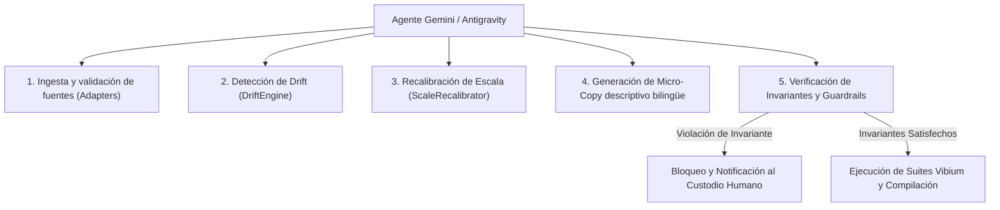

# Arquitectura del Agente de IA y Automatización Supervisada

## 1. El Rol del Agente Inteligente en el Ecosistema

El agente de IA no tiene atribuciones para alterar tesis filosóficas, redefinir la unidad de análisis ni emitir juicios de valor moral sobre las personas. Su rol está acotado estrictamente a la **adaptación paramétrica y curaduría formal**:

---

## 2. Componentes del Subsistema de Agente (`src/agent/`)

1. **`ai-adapter.js`:** Interfaz agnóstica a modelos que traduce anomalías de datos en instrucciones estructuradas para el LLM.
2. **`gemini-client.js`:** Cliente de comunicación con la API de Gemini mediante llamadas seguras con control de temperatura ($T=0.1$) para máxima reproducibilidad.
3. **`scale-recalibrator.js`:** Motor matemático determinista que recalcula las variables de altura antes de solicitar ajustes de texto al agente.

---

## 3. Barreras de Seguridad Operativa (*Safety Guardrails*)

Para evitar alucinaciones o degradación del artefacto:
* **Principio de Caja Opaca:** El agente nunca edita el código JavaScript ni la lógica de visualización; solo propone estructuras JSON que son validadas contra el esquema formal `schema.json`.
* **Aislamiento en Sandbox:** Todas las propuestas del agente se evalúan en sandboxes en memoria (`src/sandboxes/`) y se prueban con la suite Vibium antes de ser promovidas al archivo canónico `data.json`.
* **Prohibición de Generación Libre:** El agente tiene prohibido redactar textos libres sin estructura; debe rellenar plantillas predefinidas que contienen campos obligatorios (`name`, `human_scale_comparison`, `pedagogical_caption`).
