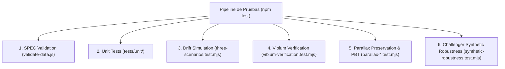

# Infraestructura de Pruebas, Verificación y Arnés de Calidad

## 1. Filosofía de Calidad: Verificación de Comportamiento Observable

El sistema implementa una política de calidad estricta (POL-ED-001, Vector 8) basada en pruebas deterministas de caja opaca:

---

## 2. Inventario de Suites de Prueba

### 2.1. Validación de Esquema (`validate-data.js`)
* Valida campos obligatorios, orden estrictamente descendente, consistencia entre patrimonio y altura, presencia de traducciones completas y rol semántico de iconos SVG.

### 2.2. Suite Unitaria (`tests/unit/`)
* `canonical-model.test.mjs`: Integridad del modelo de datos y filtrado de entidades.
* `number-formatter.test.mjs`: Formato localizado bilingüe (`1.748,50` vs `1,748.50`) y desacoplamiento de moneda/locale.
* `temporal-normalization.test.mjs`: Año dinámico y ajuste de fechas.
* `inflation-adjuster.test.mjs`: Conmutación nominal vs. valor presente y preservación de alturas.
* `drift-engine.test.mjs`: Clasificación correcta de los 4 tipos de drift.
* `guardrails.test.mjs`: Detención ante violaciones ontológicas.
* `scale-recalibrator.test.mjs`: Recalibración paramétrica de alturas.
* `pv-toggle-dom.test.mjs`: Integridad del botón toggle en el DOM, atributos ARIA y clases visuales.

### 2.3. Suite de Tres Escenarios (`tests/three-scenarios.test.mjs`)
* Evalúa la resiliencia integral ante Data Drift probable, Methodological Drift y Drift Caótico.

### 2.4. Suite Vibium (`tests/vibium-verification.test.mjs`)
* Verifica en navegadores reales bajo dos resoluciones canónicas:
  - **Mobile-First:** Viewport de $390 \times 844\text{ px}$.
  - **Desktop:** Viewport de $1920 \times 1080\text{ px}$.
* Evalúa los 12 casos extremos de estrés: datos cuasi-uniformes, asimetría de Pareto pura, datos incompletos, unidades radicales (BTC/Satoshis), deuda masiva y rechazo de personas jurídicas.

### 2.5. Pruebas Basadas en Propiedades (PBT) y Preservación de Parallax
* `parallax-bug-condition.test.mjs` y `parallax-preservation.test.mjs`: Pruebas que validan la invariante de visibilidad del fondo estelar y la aplicación correcta del factor de parallax bajo `prefers-reduced-motion`.

### 2.6. Suite de Robustez Sintética Challenger (`tests/synthetic-robustness.test.mjs`)
* Ejecuta **25 iteraciones Monte Carlo** con permutaciones aleatorias en un sandbox aislado en memoria. El Champion en producción permanece 100% inmutable durante la prueba.
