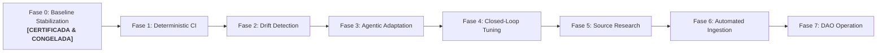

# Roadmap de Automatización Progresiva hacia Operación DAO (7 Fases)

## 1. Visión Estratégica del Roadmap

El proyecto sigue una estrategia de maduración gradual en 7 fases, evolucionando desde un artefacto estático manual hacia un sistema autónomo descentralizado con gobernanza algorítmica:

---

## 2. Descripción de las Siete Fases

| Fase | Denominación | Estado | Descripción y Objetivos |
|---|---|---|---|
| **Fase 0** | **Baseline Stabilization** | **CERTIFICADA & CONGELADA** | Línea base oficial v0.9 auditada, congelamiento de invariantes, certificación formal y ratificación del Champion. |
| **Fase 1** | **Deterministic CI** | **En Cuarentena Pasiva** | Validación 100% automatizada en GitHub Actions (`validate-spec.yml`, `npm test`) con arnés de pruebas deterministas. |
| **Fase 2** | **Drift Detection** | Planificada | Monitoreo periódico programado de fuentes primarias para detectar discrepancias estadísticas o metodológicas. |
| **Fase 3** | **Agentic Adaptation** | Planificada | Despliegue supervisado de agentes LLM para proponer recalibraciones de escala y micro-copy en sandboxes. |
| **Fase 4** | **Closed-Loop Tuning** | Planificada | Optimización autónoma de micro-copy y balanceo de contrastes visuales guiada por telemetría. |
| **Fase 5** | **Source Research** | Planificada | Búsqueda y evaluación autónoma de nuevas fuentes de datos abiertas (WID, Banco Mundial, Forbes). |
| **Fase 6** | **Automated Ingestion** | Planificada | Ingesta, parseo y firmado criptográfico continuo de datos sin intervención manual. |
| **Fase 7** | **DAO-Like Operation** | Futura | Gobernanza descentralizada con votación de contratos de abstracción por parte de la comunidad académica. |

---

## 3. Protocolo de Transición entre Fases

Ninguna fase puede iniciarse sin que la fase previa cumpla el **100% de sus criterios de salida** debidamente certificados y firmados en el `Change Log Ledger` por el Custodio de Arquitectura y el Custodio Conceptual.
