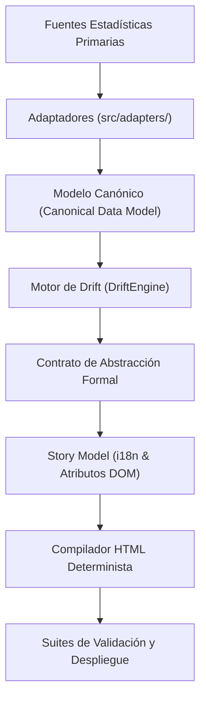

# Contrato de Abstracción y Pedagogía (CT-ABS-001)

## Código Normativo: CT-ABS-001 | Versión: 1.0.0 | Estado: [VIGENTE]

---

## 1. Desacoplamiento Total entre Datos y Presentación

El componente visual y el motor de renderizado HTML **no conocen proveedores externos ni identidades particulares**:
- No conocen *Forbes*.
- No conocen *Bloomberg*.
- No conocen a *Elon Musk* ni a ninguna persona específica en el código base.
- No asumen un número fijo de 8 estratos; operan sobre una colección dinámica de $N$ capas.

El motor visual únicamente interpreta **conceptos abstractos normalizados**:
- `metric`: Magnitud económica medida (`net_worth`).
- `population`: Proporción y conteo de individuos representados.
- `scale`: Factor de conversión física ($0.15\text{ m} / W_{\text{ref}}$).
- `reference`: Objeto físico analógico asignado según altura calculada.
- `narrative`: Título, subtítulo, captions y anuncios accesibles (ARIA).

---

## 2. Flujo de Transformación Conceptual



---

## 3. Especificación Formal del Documento de Abstracción

El documento de abstracción intermedio (`AbstractionDocument`) satisface:
```typescript
interface AbstractionDocument {
  contract_version: "2.1.0";
  scale_formula: {
    unit_value_usd: number;        // ej. 8000 USD
    step_height_meters: number;    // exactamente 0.15 m
  };
  max_height_meters: number;       // Altura máxima alcanzada en la cúspide
  layers: Array<{
    layer_id: string;              // "s1", "s2", ..., "sN"
    pedagogical_role: "BASE" | "ESCALA" | "CONTRASTE" | "CONTEXTO" | "EXTREMO";
    raw_magnitude: number;
    magnitude_unit: "USD";
    physical_height_meters: number;
    formatted_height_label: string;
    population_share_percentage: number;
    physical_reference: { name_es: string; name_en: string; svg_icon: string };
    narrative: {
      headline_es: string; headline_en: string;
      caption_es: string; caption_en: string;
      aria_es: string; aria_en: string;
    };
  }>;
  provenance: {
    dataset_id: string;
    sources: Array<{ name: string; report_date: string; payload_hash: string }>;
  };
}
```
