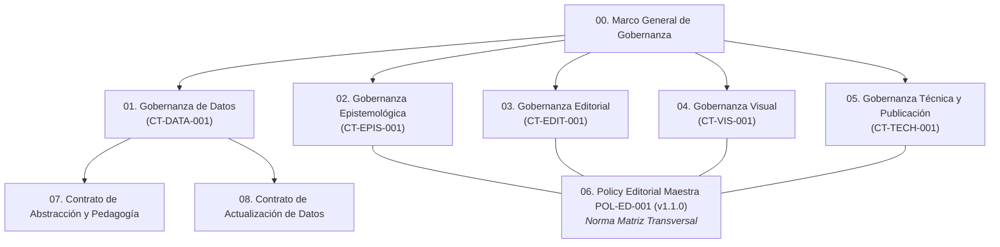

# Dominio IV: Contratos Maestros de Gobierno del Sitio Web y Ecosistema Documental

## Propósito y Alcance del Dominio
Este dominio alberga los contratos normativos que rigen el desarrollo, publicación, mantenimiento y evolución del sitio web interactivo y su ecosistema de conocimiento.

El sitio web es gobernado formalmente como un **artefacto académico, investigativo y editorial**, no meramente como una interfaz visual o un conjunto de archivos de código.

---

## Estructura de Contratos de Gobernanza

---

## Índice Canónico de Contratos

| Código | Documento | Versión | Estado | Alcance Principal |
|---|---|---|---|---|
| **GOB-000** | [`00-marco-general-de-gobernanza.md`](./00-marco-general-de-gobernanza.md) | 1.0.0 | **[VIGENTE]** | Arquitectura legal y relacional del ecosistema de contratos. |
| **CT-DATA-001** | [`01-contrato-gobernanza-de-datos.md`](./01-contrato-gobernanza-de-datos.md) | 1.0.0 | **[VIGENTE]** | Procedencia, integridad, esquemas, hashes y validación determinista. |
| **CT-EPIS-001** | [`02-contrato-gobernanza-epistemologica.md`](./02-contrato-gobernanza-epistemologica.md) | 1.0.0 | **[VIGENTE]** | Tesis, hipótesis, límites del conocimiento y blindaje contra *Drift Conceptual*. |
| **CT-EDIT-001** | [`03-contrato-gobernanza-editorial.md`](./03-contrato-gobernanza-editorial.md) | 1.0.0 | **[VIGENTE]** | Estructura narrativa, terminología bilingüe y calidad sintáctica. |
| **CT-VIS-001** | [`04-contrato-gobernanza-visual.md`](./04-contrato-gobernanza-visual.md) | 1.0.0 | **[VIGENTE]** | Isomorfismo semántico, tokens de color, contraste y WCAG 2.1 AA. |
| **CT-TECH-001** | [`05-contrato-gobernanza-tecnica-y-publicacion.md`](./05-contrato-gobernanza-tecnica-y-publicacion.md) | 1.0.0 | **[VIGENTE]** | Arquitectura Zero-Build, DOM desacoplado, navegación y reproducibilidad. |
| **POL-ED-001** | [`06-policy-editorial-maestra-pol-ed-001.md`](./06-policy-editorial-maestra-pol-ed-001.md) | 1.1.0 | **[VIGENTE]** | Norma canónica transversal de auditoría, 8 vectores y anexos. |
| **CT-ABS-001** | [`07-contrato-de-abstraccion-y-pedagogia.md`](./07-contrato-de-abstraccion-y-pedagogia.md) | 1.0.0 | **[VIGENTE]** | Escalamiento físico de Pen, escalón patrón e invarianza corporal. |
| **CT-UPD-001** | [`08-contrato-actualizacion-datos-riqueza-global.md`](./08-contrato-actualizacion-datos-riqueza-global.md) | 1.0.0 | **[VIGENTE]** | Pipeline de recálculo determinista y compilación a producción. |
