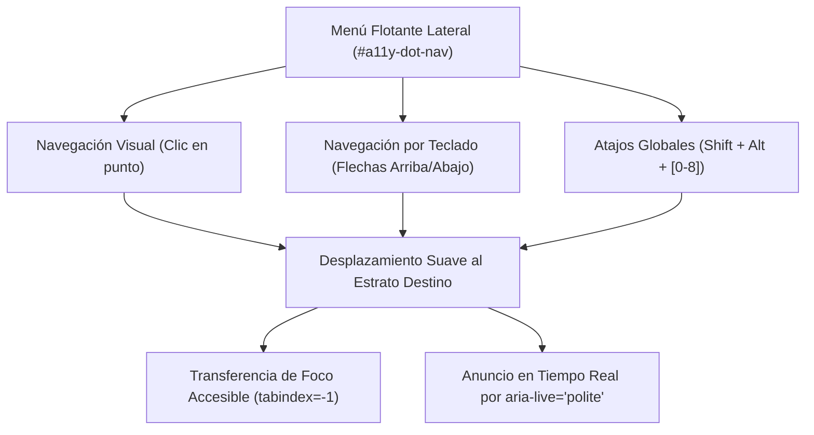

# Recorrido Scrollytelling, Interacción y Experiencia de Usuario (UX)

## 1. Mecánica de Navegación Vertical Scrollytelling

La experiencia interactiva de **¿A qué altura vives?** está estructurada como un viaje vertical inmersivo con desplazamiento fluido y anclaje magnético por sección:

```css
html {
  scroll-snap-type: y mandatory;
  overflow-x: hidden;
  scrollbar-width: none;
}
.snap {
  scroll-snap-align: start;
  min-height: 100vh;
  position: relative;
}
```

---

## 2. Sistema de Navegación Asistida y Menú Flotante (`#a11y-dot-nav`)

Para facilitar el salto rápido entre estratos sin forzar un desplazamiento continuo de 8 pantallas, el artefacto incluye un menú flotante vertical de puntos interactivos (`.a11y-dot`):



### 2.1. Atajos de Teclado Globales
* `Shift + Alt + 0`: Salto a la portada / Introducción.
* `Shift + Alt + 1`: Salto a la cúspide extrema (Satélite en órbita).
* `Shift + Alt + 7`: Salto a la mediana mundial (El escalón patrón).
* `Shift + Alt + 8`: Salto a la base del planeta (El suelo).

### 2.2. Barra de Progreso y Anuncios Live
* `#progress`: Barra horizontal de $3\text{ px}$ en la parte superior que indica el porcentaje de descenso completado.
* `#a11y-announcer`: Región `aria-live="polite"` con *debounce* de 500 ms que anuncia al lector de pantalla el estrato actual en el idioma seleccionado.

---

## 3. Conmutador Dual de Cifras (Nominal / Valor Presente)

Ubicado en el clúster superior derecho (`.top-right-controls`), el conmutador permite conmutar instantáneamente entre datos históricos originales de la fuente y cifras a valor presente ajustadas por inflación CPI-U ($+5,4\%$), actualizando los atributos `textContent`, `aria-label` y los badges de procedencia en el DOM sin recargar la página.
