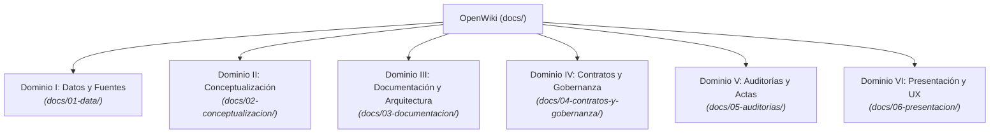

# 🌌 OpenWiki — ¿A qué altura vives? / How High Do You Stand?

### *Sistema Canónico de Gobernanza del Conocimiento, Arquitectura Documental y Auditoría Epistemológica*

---

Bienvenido al centro de documentación y verdad canónica de **¿A qué altura vives?** (*Step 4: Global Inequality / Ruta del Pensamiento Crítico*).

Este ecosistema organiza el conocimiento del proyecto bajo una estricta **separación de responsabilidades**, gobernado por contratos maestros y la norma transversal **POL-ED-001 (v1.1.0)**.

---

## 🏛 Arquitectura de Dominios

### [Dominio I: Datos, Fuentes y Procedencia](01-data/README.md)
Custodia las fuentes primarias oficiales (UBS Global Wealth Report 2024, Forbes Real-Time, BLS CPI-U), el modelo canónico JSON, el diccionario de variables y la normalización temporal inflacionaria.

### [Dominio II: Conceptualización, Teoría y Filosofía](02-conceptualizacion/README.md)
Fundamenta el experimento mental del Desfile de Jan Pen (1971), la función de transferencia lineal con *Lie Factor* = 1.0, el invariante ontológico de Persona Natural exclusiva y el multiperspectivismo normativo (*steelmanning* de Rawls, Hayek, Piketty y Sen).

### [Dominio III: Metodología, Arquitectura y Pruebas](03-documentacion/README.md)
Documenta la arquitectura Zero-Build, el algoritmo de recalibración dinámica del escalón, el motor de drift (`DriftEngine`), la supervisión de agentes de IA, la suite de pruebas deterministas (`npm test`) y el roadmap hacia una operación DAO en 7 fases.

### [Dominio IV: Contratos Maestros de Gobierno](04-contratos-y-gobernanza/README.md)
Los cinco contratos maestros de gobierno del sitio web (Datos, Epistemología, Editorial, Visual, Técnico), acompañados por la **Policy Editorial Maestra POL-ED-001 (v1.1.0)** y los contratos de abstracción y actualización.

### [Dominio V: Auditorías, Evaluaciones y Actas](05-auditorias/README.md)
Contiene los informes de auditoría oficiales sobre el artefacto principal `Escala-visual-de-riqueza-mundial.html`, la plantilla `AUDIT_REPORT_TEMPLATE.md`, la lista de chequeo de 20 puntos y las auditorías de calibración del escalón patrón.

### [Dominio VI: Presentación, Gramática Visual y UX](06-presentacion/README.md)
Define los tokens de diseño de la paleta atmosférica parallax, el inventario canónico de activos SVG, los atajos de teclado accesibles y los componentes interactivos del scrollytelling.

---

## 🧭 Puntos de Entrada para Agentes e Investigadores

- **Para consultar el dataset oficial:** [`OpenWiki/spec/data.json`](../OpenWiki/spec/data.json) y [`docs/01-data/02-modelo-canonico-y-esquema.md`](01-data/02-modelo-canonico-y-esquema.md).
- **Para validar la integridad del sistema:** Ejecutar `npm run validate-spec` y `npm test`.
- **Para auditar un nuevo cambio o artefacto:** Aplicar [`docs/05-auditorias/CHECKLIST_20_PUNTOS.md`](05-auditorias/CHECKLIST_20_PUNTOS.md) y [`docs/04-contratos-y-gobernanza/06-policy-editorial-maestra-pol-ed-001.md`](04-contratos-y-gobernanza/06-policy-editorial-maestra-pol-ed-001.md).
- **Para explorar el artefacto interactivo en vivo:** Abrir [`Escala-visual-de-riqueza-mundial.html`](../Escala-visual-de-riqueza-mundial.html) o visitar [Demo en GitHub Pages](https://willkwolf.github.io/global-inequality-21Century/).
